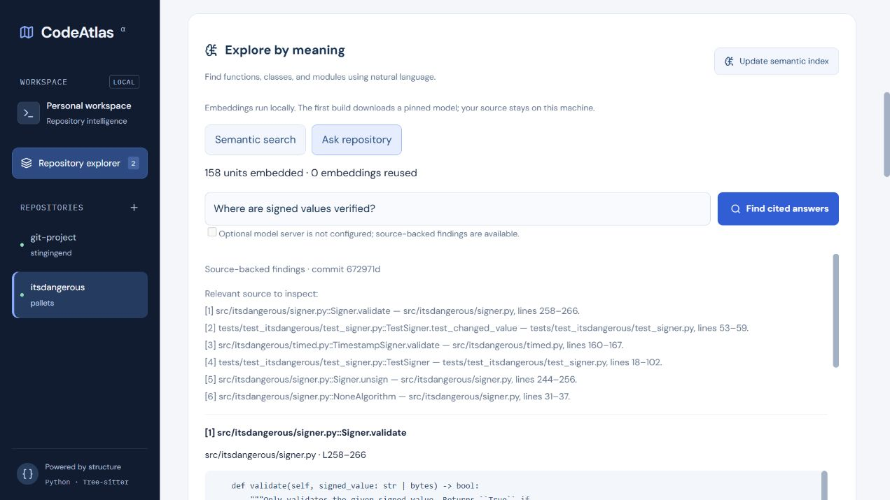

# CodeAtlas

A code intelligence platform for public GitHub repositories containing Python, JavaScript, and TypeScript: structural indexing, navigation, semantic retrieval, cited questions, dependency analysis, and PR impact reports.

Structural tools, local semantic search, and source-backed findings work without an external LLM or API key. Generated explanations use an optional compatible model server.

The website now has a public product home at `/` and the repository tools at `/workspace`. For a hosted personal workspace, the [Render deployment guide](docs/hosting.md) covers the checked-in Blueprint, private API, database, and password gate. Creating hosted services requires a Render account and review of its paid resource summary.

## Local release: v0.22

Repositories can now mix Python, JavaScript, and TypeScript, including JSX/TSX. Re-index to collect the additional languages, then filter source files by language. See [language support](docs/languages.md) for supported definitions, relative-import resolution, call-analysis limits, and cache upgrades.

The remaining local roadmap is implemented: versioned migrations, broader call candidates, local semantic embeddings, source-cited questions, change impact, public PR reports and signed webhooks, architecture metrics, and benchmarks. Re-indexing preserves unchanged file indexes and saves run summaries. The website groups the new tools into semantic search, cited questions, impact/architecture, and PR panels.

| Feature | Guide |
| --- | --- |
| Incremental indexing and saved jobs | [Reuse](docs/incremental.md), [jobs](docs/jobs.md) |
| Approximate cross-file calls | [Call candidates](docs/cross-file-calls.md) |
| Meaning-based local search | [Semantic search](docs/semantic-search.md) |
| Source-backed questions and optional generation | [Cited questions](docs/questions.md) |
| Reverse dependencies, cycles, and hubs | [Impact and architecture](docs/impact-and-architecture.md) |
| Public PR reports and authenticated webhook intake | [Pull requests](docs/pull-requests.md) |
| Schema upgrades and operational checks | [Migrations](docs/migrations.md), [release](docs/release.md) |
| Reproducible performance measurements | [Benchmarks](docs/benchmarking.md) |

Private-repository OAuth, distributed queues, and GitHub App comment publishing remain separate account/product extensions. The hosting Blueprint prepares a single-owner deployment; it does not activate paid services or post messages.

With Docker Desktop running, start from the repository root:

```powershell
Copy-Item .env.docker.example .env.docker
docker compose --env-file .env.docker up --build --wait
```

Open **http://127.0.0.1:13000** for the container website. The manual local setup below still uses SQLite and port 3000.



### Run locally

Requires Python 3.11 or newer, Git on the API server's PATH, and Node.js 24 with npm for the frontend.

```powershell
python -m venv .venv
.\.venv\Scripts\python.exe -m pip install -e './backend[test]'
.\.venv\Scripts\python.exe -m uvicorn app.main:app --app-dir backend --reload --host 127.0.0.1 --port 8001
```

Keep the API terminal open. In a second terminal, starting from the repository root:

```powershell
cd frontend
npm ci
npm run dev
```

Open **http://127.0.0.1:3000**. Enter a URL such as `https://github.com/pallets/itsdangerous` and click **Index repository**. No JSON is needed in the web form. The UI runs registration, ingestion, and parsing in order and displays the resulting stored statistics. Select a file, then use its **Source** and **Symbols** tabs.

The frontend sends `/api/*` requests through Next.js to `http://127.0.0.1:8001`. If the backend uses a different address, copy `frontend/.env.example` to `frontend/.env.local`, change `API_URL`, and restart Next.js. For production builds, set `API_URL` before building. There are no browser-side secrets and no additional CORS configuration is needed for this local proxy.

Both servers bind to localhost. See [release operations](docs/release.md) for external activation and hosting requirements. To stop a server, press **Ctrl+C** in its terminal. If port 3000 is occupied, stop the old frontend or run `npm run dev -- --port 3001`.

Open [the health endpoint](http://127.0.0.1:8001/health) or [the API documentation](http://127.0.0.1:8001/docs).

The API creates `codeatlas-metadata.db` in the directory where you start it. This file is ignored by Git. You can set `DATABASE_URL` before startup to choose another SQLite database, for example:

```powershell
$env:DATABASE_URL = 'sqlite:///./my-codeatlas.db'
```

PostgreSQL is optional; see [the deployment guide](docs/deployment.md). Startup runs versioned Alembic migrations; see [migration and backup notes](docs/migrations.md). Data transfer between databases remains a separate operation.

Startup creates missing tables alongside existing data. After pulling updates, install dependencies and restart the servers. Re-index previously parsed repositories once to populate the versioned per-file cache; subsequent runs reuse unchanged file indexes.

Expected response from `GET /health`:

```json
{"status": "ok"}
```

### Register a repository

With the API running, open another PowerShell terminal:

```powershell
$body = @{ github_url = 'https://github.com/pallets/flask' } | ConvertTo-Json
Invoke-RestMethod -Method Post -Uri 'http://127.0.0.1:8001/repositories' -ContentType 'application/json' -Body $body
Invoke-RestMethod -Uri 'http://127.0.0.1:8001/repositories'
Invoke-RestMethod -Uri 'http://127.0.0.1:8001/repositories/1'
```

The last command uses the ID returned by the first command; `1` is an example for a new database.

| Endpoint | Result |
| --- | --- |
| `GET /health` | Process liveness |
| `POST /repositories` | Register URL metadata; return `201` |
| `GET /repositories` | List registered repositories by ID |
| `GET /repositories/{id}` | Retrieve one record; return `404` if missing |

Registration accepts an HTTPS `github.com/owner/repo` URL. Trailing slashes and `.git` suffixes are normalized, and owner/repository casing is lowered. The unique URL constraint prevents duplicate records, returning `409`. Invalid URLs or payloads return `422`.

Registration validates the URL's format only. It does not contact GitHub, verify that a repository exists or is public, clone source, or index code. Its status is `registered` to make that distinction explicit.

### Ingest a registered repository

Using the ID returned by registration:

```powershell
Invoke-RestMethod -Method Post -Uri 'http://127.0.0.1:8001/repositories/1/ingest'
Invoke-RestMethod -Uri 'http://127.0.0.1:8001/repositories/1/snapshot'
Invoke-RestMethod -Uri 'http://127.0.0.1:8001/repositories/1/files'
```

For a smaller first example, register `https://github.com/pallets/itsdangerous`.

| Endpoint | Result |
| --- | --- |
| `POST /repositories/{id}/ingest` | Clone, discover, and save a source snapshot synchronously |
| `GET /repositories/{id}/snapshot` | Commit, branch, ingestion time, file count, skipped files, and total lines |
| `GET /repositories/{id}/files` | File paths, language, SHA-256 hashes, and line counts |

Successful ingestion changes the repository status to `ingested`. This means source has been collected; no symbols have been parsed yet. Re-ingestion replaces the snapshot atomically. A failure preserves the previous snapshot, or leaves a new repository `registered`. The temporary clone is removed before the database transaction commits. A repository with no eligible Python files succeeds with a file count of zero.

The synchronous ingestion endpoint remains available for API clients. The website uses durable background jobs. Use one API process/instance per database: a shared local lock allows one indexing operation at a time and returns `409` if busy. Clone/read/limit failures return `422`; missing records or snapshots return `404`. See [job progress and recovery](docs/jobs.md).

### Ingestion limits

- HTTPS GitHub URLs only; Git redirects and credential helpers are disabled.
- Shallow, single-branch clone with no checkout, hooks from repository code, submodule traversal, or LFS downloads. Repository code and dependencies are never executed.
- Clone timeout: 90 seconds. Clone disk usage: 150 MB, checked while cloning and after it exits. Transport children are terminated on a limit failure. These application checks are not operating-system resource quotas.
- Up to 20,000 tracked entries, 2,000 eligible Python files, and 25 MB eligible Python source. Individual files over 1 MB are skipped.
- Tracked regular `.py` files only. Git symlinks and generated/vendor/virtual-environment/cache folders are skipped. Untracked local files are never scanned.
- UTF-8 and UTF-8 BOM source only; unsupported encodings are skipped. The skipped count refers to Python files excluded by these rules.
- Source text is saved for parsing. The file-list API exposes metadata, not source text.

This is still a local development API. Public hosting needs authentication, rate limiting, and stronger worker isolation.

### Parse the saved source

After a successful ingestion, use its repository ID:

```powershell
Invoke-RestMethod -Method Post -Uri 'http://127.0.0.1:8001/repositories/1/parse'
Invoke-RestMethod -Uri 'http://127.0.0.1:8001/repositories/1/parse'
Invoke-RestMethod -Uri 'http://127.0.0.1:8001/repositories/1/parse/files'
Invoke-RestMethod -Uri 'http://127.0.0.1:8001/repositories/1/symbols?kind=method&limit=100&offset=0'
```

| Endpoint | Result |
| --- | --- |
| `POST /repositories/{id}/parse` | Parse saved Python source and atomically save results |
| `GET /repositories/{id}/parse` | Counts by symbol type, commit, timestamp, and number of files with syntax errors |
| `GET /repositories/{id}/parse/files` | Per-file symbol counts and syntax-error flags |
| `GET /repositories/{id}/symbols` | Symbols ordered by file and source position; optional `file_id` and `kind` filters |

Symbol listing defaults to 100 records per page. Use `limit` (1–500) and `offset` (0 or greater) to inspect additional results. The allowed kinds are `function`, `class`, `method`, and `import`.

Parsing works entirely from saved source; it does not contact GitHub or execute code. The repository becomes `parsed`, even when Tree-sitter reports recoverable syntax errors. Check `parse_error_files` and the per-file flags: recovered definitions may be incomplete. The parse result records the same commit as the ingested snapshot.

Re-parsing replaces old results in a transaction. Re-ingestion clears old symbols and parse metadata before replacing source, returning the status to `ingested`. Ingestion and parsing share the same per-process lock; use one worker. Parsing before ingestion returns `409`, while a symbol-limit failure returns `422` and preserves earlier results. The repository-wide extraction limit is 100,000 symbols.

Qualified names use `path.py::Class.method` or `path.py::function`. Start and end lines are 1-based and inclusive, starting at the `def`, `async def`, or `class` line rather than decorators. Imports count statements, including `from __future__` and imports inside functions; importing several names in one statement counts once. Repeated overloads keep separate records with the same qualified name and different source ranges. Lambdas and variable assignments are not extracted in this milestone.

Tree-sitter is pinned to 0.25.2 with the Python grammar at 0.25.0. Earlier local validation found a native traversal crash with the 0.26.0 Windows wheel. Check real repositories before changing these pins.

### Inspect the index

In the API documentation, follow the three numbered POST operations: **register**, **download source**, and **extract symbols**. Registration takes JSON in the **Request body** box; the later operations take the numeric `repository_id` returned by registration.

Once those stages finish, use these read endpoints:

| Endpoint | Result |
| --- | --- |
| `GET /repositories/{id}/overview` | `repository` metadata, ingestion `snapshot` statistics, and `parsing` statistics |
| `GET /repositories/{id}/files/{file_id}` | File metadata, full saved source, commit link, parse flags, and a page of symbols |
| `GET /repositories/{id}/symbols/{symbol_id}` | Symbol metadata, its file, source snippet, syntax-error flag, and a GitHub line link |

Get `file_id` values from `/repositories/{id}/files` and `symbol_id` values from `/repositories/{id}/symbols` or a file's symbol page. IDs belong to the current saved index; refresh the lists after re-ingestion or re-parsing. A detail ID from another repository returns `404`.

An overview works before ingestion or parsing. Its `snapshot` is `null` until source is saved; `parsing` is `null` until extraction finishes. Zero counts in a completed stage mean zero results, while `null` means the stage has not completed. Syntax-error counts remain visible even after the status becomes `parsed`.

File detail returns a `symbols` object with `items`, `total`, `limit`, and `offset`. Its page size defaults to 100, with a maximum of 500. `total` is `null` for an unparsed file and zero for a parsed file with no symbols. Example:

```powershell
$repositoryId = 1 # replace with the ID returned by registration
$base = "http://127.0.0.1:8001/repositories/$repositoryId"
$overview = Invoke-RestMethod -Uri "$base/overview"
$files = Invoke-RestMethod -Uri "$base/files"
$file = Invoke-RestMethod -Uri "$base/files/$($files[0].id)?limit=20&offset=0"
$file.source
$file.symbols.items
```

If the file has symbols, inspect one with:

```powershell
$symbol = Invoke-RestMethod -Uri "$base/symbols/$($file.symbols.items[0].id)"
$symbol.source
$symbol.github_url
```

Use the port your API server is running on; the current examples use `8001`. Choose a file with symbols for the last example.

These GET endpoints only read stored data. They do not clone, parse, execute source, or write records. Links use `/blob/{commit_sha}/...`, including line fragments for symbols. Snippets preserve indentation and internal line breaks, omitting the LF after the last selected line. The SQLite inspection endpoints use a read transaction to keep source and symbol queries on one snapshot during concurrent writes.

### Search symbols and jump to source

After indexing, use **Find a definition** to search the selected repository. Type a name such as `sign`, a qualified name such as `::Signer.sign`, a signature fragment, or a file path. Filter by function, class, method, or import, and use the result-page controls for more matches.

Select a result to open its file and highlight the definition. The viewer automatically selects the correct 200-line source page and scrolls within that pane. The **Symbols** tab now selects source in the same way. The **GitHub** link opens the selected lines at the indexed commit; **Clear source selection** removes the highlight.

Search is a literal substring lookup over stored names, qualified names, signatures, and paths. It does not search arbitrary function bodies or interpret natural language. `%` and `_` are literal characters, not wildcard syntax. SQLite provides case-insensitive matching for ASCII; non-ASCII case folding is not promised. Exact names rank first, followed by name prefixes, then other matches in deterministic file/source order.

```powershell
Invoke-RestMethod -Uri 'http://127.0.0.1:8001/repositories/1/search?q=sign&kind=method&limit=20&offset=0'
```

`GET /repositories/{id}/search` accepts `q` (at most 200 characters, trimmed to a non-empty term), optional `kind`, `limit` (1–100, default 20), and `offset` (0 or greater). It returns a total count, a page of `{symbol, path, has_parse_errors}` items, the normalized query, and the parsed commit hash. For an unparsed repository, `parsed` is false, the commit is null, and results are empty. Missing repositories return `404`; invalid parameters return `422`.

The UI waits 200 ms after typing and ignores obsolete responses when the query or repository changes. Re-indexing clears the current search and source selection. Navigation verifies symbol identity and commit before showing source; if the index changed externally, refresh the page and search again. Search reads the saved index without cloning or executing code.

### Run the tests

From the repository root:

```powershell
.\.venv\Scripts\python.exe -m pytest backend/tests -q
```

### Reproducible benchmarks

```powershell
.\.venv\Scripts\python.exe scripts/benchmark_index.py --files 100 --changed 4 --repeat 3 --semantic --output docs/benchmark-latest.json
```

The isolated fixture preserves the user's database and checks unchanged IDs. The [committed run and methodology](docs/benchmarking.md) measured median parsing/publication of 365 ms full and 143 ms incremental, with 96 of 100 files reused. Clone and discovery costs are measured separately.

### Frontend checks and production build

From `frontend/`:

```powershell
npm test
npm run typecheck
npm run build
npm start
```

`npm test` uses Node 24's built-in test runner to exercise request handling and workflow order with fake HTTP responses. A production build and `npm start` still need the FastAPI server running. The npm lockfile makes dependency installation repeatable.

The UI displays saved repositories on load. **Index repository** or **Re-index** submits a background job, recollects source, and reuses unchanged indexes. A failure keeps the backend's last committed stage; the error appears in the page and the repository can be retried. Reloading reconnects to saved progress, and closing the tab does not cancel indexing.

Source is rendered as text, never HTML. The viewer shows at most 200 source lines at a time. File symbols use the API's 100-record pages; select a symbol to open its source. The GitHub link points to the indexed commit and the selected line range. The file filter matches file paths locally; repository-wide search uses the backend index.

## How this step works

1. Register a canonical GitHub URL and get a repository ID.
2. The ingestion service clones it into a temporary directory without checking it out.
3. `git ls-tree` discovers tracked entries; `git cat-file` reads eligible blobs from that commit.
4. SQLAlchemy saves the source files, snapshot metadata, and `ingested` status in one transaction.
5. Tree-sitter parses the saved source into a syntax tree. An iterative traversal extracts definitions and their enclosing scopes.
6. A second transaction saves symbols, per-file parse flags, summary counts, and the `parsed` status.
7. Tests use real local Git fixtures and isolated databases. Parser fixtures exercise scopes, signatures, recovery, limits, and snapshot invalidation.
8. The index query module combines existing stored records for overview, file inspection, and symbol source inspection.

The `/health` endpoint checks that the API process responds. It does not check the database or GitHub.

See [the metadata walkthrough](docs/metadata-storage.md) for an explanation of tables, sessions, transactions, and the application factory.

See [the ingestion walkthrough](docs/ingestion.md) for Git objects, source discovery, and snapshot replacement.

See [the parsing walkthrough](docs/parsing.md) for syntax trees, scope tracking, symbol records, and recovery behavior.

See [the index inspection walkthrough](docs/index-inspection.md) for the read API used by the explorer.

See [the roadmap](docs/roadmap.md) for completed milestones and remaining external activation.

See [the frontend walkthrough](docs/frontend.md) for component state, the API proxy, and the indexing workflow.

See [the search walkthrough](docs/symbol-search.md) for literal matching, paging, selection, and stale-index handling.
