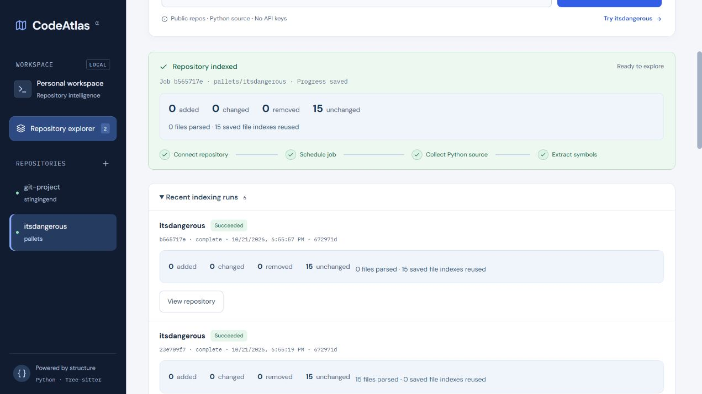

# Phase 13: incremental indexing

Click **Re-index** on an existing repository. The API still discovers Python files from a fresh shallow clone, then compares each path and SHA-256 content hash with saved source. This phase reduces database replacement and syntax extraction; it does not cache Git clones or promise a particular speedup when network time dominates.

| File state | Source and index behavior |
| --- | --- |
| Added | Insert source and extract its symbols, scopes, and calls |
| Changed | Update source at the same file ID, replace that file's syntax index |
| Removed | Delete its source and dependent index records |
| Unchanged | Preserve source, symbol, and call IDs; reuse its syntax index |
| Unchanged with an old/missing cache | Parse once to establish a compatible cache |

Paths define file identity. A rename is an addition and removal. A documentation-only commit still updates the repository commit SHA, with zero files parsed once the cache is populated. Changed definitions do not have a stable symbol-ID guarantee. Source is never executed.

## Cache and graph correctness

New `file_index_states` rows store the file hash, index-format version, exact ordered symbol IDs, and parent indices as JSON. Persisting exact parents preserves separate scopes even when definitions have duplicate qualified names. Reuse checks the format version, hash, symbol membership/count, and valid parent ordering. A missing or invalid cache causes a fresh parse. Existing databases acquire these new tables at startup without altering or deleting old tables. First re-index after upgrading parses existing files once.

`INDEX_FORMAT_VERSION` must change when extraction, scope serialization, or same-file call matching changes. All cached files are then parsed again. Global symbol and call limits include both cached and newly extracted records.

Containment and import relationships are rebuilt for the complete current inventory, including reused files. An unchanged import can therefore resolve after a module is added, or become unresolved when a target disappears. Call records can be retained because the current approximate call matcher only resolves definitions within the same file. Broader cross-file call resolution will need additional invalidation rules.

Ingestion invalidates repository-wide parse, call, and relationship markers while retaining valid unchanged per-file data. Search reports `parsed: false` until parsing publishes the new markers; direct file/symbol inspection may still show retained unchanged records. Both stages retain their existing transactional rollback behavior. The worker serializes mutations; one API instance per database remains required.

## Saved run summaries

`GET /jobs/{id}` and `GET /jobs?limit=10` include nullable `changes`:

```json
{
  "added": 0,
  "changed": 0,
  "removed": 0,
  "unchanged": 15,
  "parsed_files": 0,
  "reused_files": 15
}
```

The website displays these counts in the current run and recent history. Ingestion saves the inventory counts in the same transaction as the source update. Parsed/reused counts remain null until parsing succeeds. The per-job `job_changes` copy stays attached to its original run, even after later jobs. Jobs from before this phase, and jobs that fail before ingestion commits, have no summary. `index_changes` holds the latest repository counters for the worker; synchronous ingestion/parsing also updates those counters but does not create job history.

Added/changed/removed/unchanged count source inventory differences; parsed/reused count syntax work. An unchanged file can still be parsed after a cache upgrade. Failures and interrupted jobs retain the last committed stage and summary.

## Verification

Tests use real temporary Git revisions to check additions, changes, removals, stable symbol/call IDs, documentation-only commits, and unchanged importers gaining/losing targets. Other checks cover exact duplicate scopes, cache upgrades/corruption, cached-record limits, database-write rollback, durable job summaries, and PostgreSQL foreign keys. The browser check runs a real public repository twice: the upgrade seeds its cache, then the next run reports zero parsed files and fifteen reused indexes.


