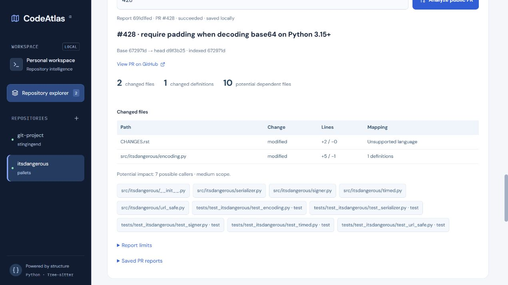

# Phase 19: public pull request analysis

Open **Public pull request analysis**, enter a PR number for the selected public repository, and run analysis. Reports execute in a bounded background worker, survive reloads, and are saved locally. GitHub is read anonymously; API rate limits apply. No comments, reviews, or other messages are posted.

The analyzer reads PR metadata and paginated changed files through the [GitHub REST API](https://docs.github.com/en/rest/pulls/pulls#list-pull-requests-files), capped at 500 files and bounded response sizes/timeouts. It verifies the base and head have not changed during retrieval. Repository source is never executed.

Changed definitions are mapped against old-side diff lines **only when the indexed commit exactly matches the PR base**. Otherwise the report requests the base index and shows no speculative symbol impact. **Index PR base** starts a normal saved indexing job targeting that full commit SHA; it uses a bounded shallow bare fetch with the same storage/time/source limits. Then analyze the PR again. **Re-index** restores the default branch when needed.

Missing/truncated patches conservatively select all definitions in an indexed file. Insertions select neighboring old-line anchors; removed or renamed files select their old definitions. New files and unsupported languages are labeled; they have no known reverse edges yet. Reports list changed definitions, potentially affected callers/files/tests, and analysis limits. Impact remains approximate.

API:

- `POST /repositories/{id}/pull-requests` with `{"number": 42}` returns a saved report ID with 202.
- `GET /repositories/{id}/pull-requests/{report_id}` polls that report.
- `GET /repositories/{id}/pull-requests?limit=10` lists saved reports.
- `POST /repositories/{id}/jobs` optionally accepts `{"commit_sha": "full-lowercase-40-character-sha"}`.

## Optional signed webhooks

Set a random `CODEATLAS_WEBHOOK_SECRET` of at least sixteen characters, restart the API, and configure GitHub to send `pull_request` events to `/webhooks/github` through a properly secured deployment. Localhost is not externally reachable. Configuration in GitHub and public hosting are account-owned activation steps; this implementation does not create a GitHub App or expose the local server.

The receiver verifies [HMAC-SHA256 over the raw body](https://docs.github.com/en/webhooks/using-webhooks/validating-webhook-deliveries), limits payload size, requires a delivery ID, and deduplicates saved deliveries. Opened, reopened, and synchronized PR events schedule reports for already registered public repositories. Other events/actions are ignored. Webhooks do not replace the current repository snapshot automatically and do not post comments.

The release browser check analyzed `pallets/itsdangerous` PR #428 against indexed base `672971d`, finding two changed files, one changed definition, seven possible callers, and ten potential dependent files. These are static candidates for that captured PR revision.

One PR worker runs per API process with one active report; additional work receives 409 and can be retried. The queue is not distributed. Restart marks unfinished reports interrupted. Migration `005_pull_requests` adds report and target-commit records. Tests cover signed/invalid/duplicate deliveries, exact-base mapping, mismatch behavior, worker recovery, targeted indexing, and known downstream test dependents.
